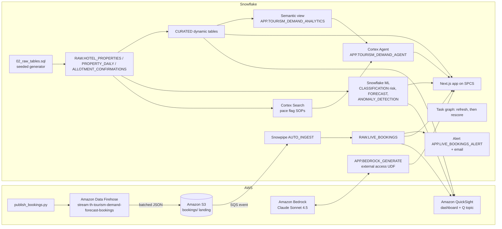

# Thailand Tourism Demand Forecast - Booking Pace Flags and Early Sell-out Risk

End-to-end room-night demand forecasting for **40 fictional hotel properties of a fictional Thai hospitality group, in 5 destinations** (Bangkok, Phuket, Chiang Mai, Pattaya, Krabi) using Snowflake, optionally with AWS: from a live channel booking event to a 7-day early sell-out risk score, a network room-night forecast, an alert email and an AI action memo for the revenue management team.

## Architecture

A room-night demand pipeline built on **Snowflake** (Dynamic Tables, Snowflake ML, Cortex Search, Cortex Agent, Cortex AI_COMPLETE, SPCS) and, in the full build, **AWS** (Amazon Data Firehose, S3, Bedrock Claude, QuickSight + Amazon Q). Channel booking events land in `RAW.LIVE_BOOKINGS`. Dynamic tables curate 90 days of property-day history: room nights sold, room revenue, booking pace flags raised, early sell-outs, allotment recalls, flag-free day rate and pickup review adherence. Snowflake ML scores 7-day early sell-out risk per property, forecasts network-wide daily room nights and flags pickup forecast error anomalies. A Cortex Agent answers questions with SOP citations, and an LLM drafts the revenue action memo.

An early sell-out is a property-day that sold out ahead of forecast, so late demand was turned away at rates set too low. A pace flag is raised when bookings for a stay date run ahead of the expected pickup curve.

Interactive diagrams (hover for object names): [Snowflake only](docs/architecture-snowflake.html) | [AWS + Snowflake](docs/architecture-aws.html). The app shows both on its Architecture & Data tab, the current build first. Regenerate them with `python3 docs/build_architecture.py aws snowflake`.



The Snowflake-only build drops the AWS subgraph: `APP.SIMULATE_BOOKINGS` writes to `RAW.LIVE_BOOKINGS`, and the app calls Cortex `AI_COMPLETE` instead of the Bedrock UDF.

## Snowflake Capabilities

| Capability | Implementation |
|-----------|---------------|
| Dynamic Tables | `CURATED.KPI_SUMMARY`, `PERFORMANCE_SUMMARY`, `PACE_FLAG_SUMMARY`, `TREND_ANALYSIS` from the RAW tables |
| Snowflake ML | CLASSIFICATION 7-day early sell-out risk (`ML.SELLOUT_RISK_SCORES`), 14-day network room-night FORECAST (`ML.ROOM_NIGHT_FORECAST`), pickup forecast error ANOMALY_DETECTION |
| Cortex Search | 14 synthetic pace flag handling SOPs (one per property segment and pace flag type) in `SEARCH.PACE_SOP_SEARCH` |
| Semantic View | `APP.TOURISM_DEMAND_ANALYTICS` over properties, pace flag types, daily totals and risk |
| Cortex Agent | `APP.TOURISM_DEMAND_AGENT`: Cortex Analyst over the semantic view plus Cortex Search for SOP citations |
| Cortex AI | `AI_COMPLETE('claude-sonnet-4-5')` for grounded answers, and for the action memo in the Snowflake-only build |
| Alerts + Tasks | `APP.LIVE_BOOKINGS_ALERT` logs PACE_FLAG events and sends email; task graph `TASK_REFRESH_CURATED`, then `TASK_RESCORE_RISK` |
| Snowpark Container Services | Next.js app `APP.TH_TOURISM_DEMAND_FORECAST_APP` with 6 tabs: Executive Cockpit, Predictive, Controls, Live Bookings, Ask AI, Architecture & Data |
| Snowpipe | `RAW.LIVE_BOOKINGS_PIPE` AUTO_INGEST from S3 (AWS build only) |

## AWS Services

Used only in the AWS + Snowflake build.

| Service | Role in Demo |
|---------|-------------|
| Amazon Data Firehose | Direct PUT Firehose stream `th-tourism-demand-forecast-bookings` receives simulated channel booking events and writes batches to S3 |
| Amazon S3 | Landing bucket (`bookings/`). An event notification goes to the Snowpipe SQS queue |
| Amazon Bedrock | Claude Sonnet 4.5 writes the action memo, called from Snowflake through an external-access UDF |
| Amazon QuickSight | DIRECT_QUERY executive dashboard over Snowflake (daily pace flags, early sell-outs by property, early sell-out risk) |
| Amazon Q | Natural-language questions over the QuickSight topic `th-tourism-demand-forecast-topic` |
| AWS IAM | Least-privilege roles for S3, Firehose and Bedrock |

## Personas

These personas are fictional.

| Persona | Role | Key Questions |
|---------|------|---------------|
| **Siriporn Wattanakul** | Director of Revenue Management, fictional Thai hotel group | "What share of property-days run without a pace flag?" "Which pace flag types turn into early sell-outs?" |
| **Kittipong Srisuk** | Revenue Analyst | "Which properties are high early sell-out risk this week, and which SOP applies?" |

## Data

All data is synthetic and seeded, so every rebuild reproduces it. The hotel group, properties, channel partners and names are fictional; the cities are real Thai destinations used as property locations.

| Table | Rows | Description |
|-------|------|-------------|
| RAW.HOTEL_PROPERTIES | 40 | Properties in 5 destinations and 5 segments (Upscale hotel, Midscale hotel, Boutique hotel, Serviced apartment, Luxury resort), with demand volatility tier and pickup review cadence |
| RAW.PROPERTY_DAILY | 3,600 | Daily property observations over 90 days: room nights sold, room revenue (THB), pace flags, early sell-outs, allotment recalls, pace flag type, pickup reviews, pickup forecast error and rate response time |
| RAW.ALLOTMENT_CONFIRMATIONS | 40 | Required, signed and pending allotment and group contract confirmations per property |
| SEARCH.PACE_DOCS | 14 | Synthetic pace flag handling SOPs indexed for Cortex Search |
| RAW.LIVE_BOOKINGS | Grows during the demo | Live channel booking events from Firehose (AWS build) or `APP.SIMULATE_BOOKINGS` (Snowflake-only build) |
| ML.SELLOUT_RISK_SCORES | 40 | 7-day early sell-out probability and risk band per property |

## Build Instructions

### Prerequisites
- Snowflake account with ACCOUNTADMIN access, and Cortex AI enabled (AI_COMPLETE, Search, Agent).
- An X-Small warehouse with auto-suspend at or below 120 s, and an existing SPCS compute pool.
- Python 3.11+, `snowflake-connector-python`, Node.js 22+, Docker and the `snow` CLI.
- App image: run `snow spcs image-registry login`, then build and push `th-tourism-demand-forecast-app:v1` to the database's `APP.IMAGES` repository (see the header of `snowflake/07_deploy_app.sql`).
- AWS build only: `boto3`, AWS credentials for the target account (us-west-2) with Bedrock access, and QuickSight Enterprise.

### SPCS App
```
<DATABASE>.APP.TH_TOURISM_DEMAND_FORECAST_APP
```

### Tests
```bash
python -m pytest aws snowflake quicksight
```

For a local run, put `SNOWFLAKE_ACCOUNT`, `SNOWFLAKE_USER`, `SNOWFLAKE_DATABASE`, `SNOWFLAKE_WAREHOUSE`, `SNOWFLAKE_AUTHENTICATOR=PROGRAMMATIC_ACCESS_TOKEN`, `SNOWFLAKE_TOKEN` and `DEMO_PLATFORM` in the environment, then run `npm --prefix app run build && npm --prefix app start`.

## Build Modes

Both modes share the same core. They differ in three places, and the app's `DEMO_PLATFORM` setting (in its SPCS spec) switches the memo provider and the Live Bookings tab.

| Layer | Snowflake Only | Full AWS + Snowflake |
|---|---|---|
| Live bookings | `CALL APP.SIMULATE_BOOKINGS(n)` inserts simulated channel booking events into `RAW.LIVE_BOOKINGS`. This simulates a channel booking feed; it is not Snowpipe Streaming | `aws/publish_bookings.py` to Amazon Data Firehose, then S3, SQS and Snowpipe AUTO_INGEST |
| Action memo | Cortex `AI_COMPLETE('claude-sonnet-4-5')` | Amazon Bedrock Claude Sonnet 4.5 through `APP.BEDROCK_GENERATE` |
| BI and natural-language questions | The SPCS app is the dashboard; questions go to the Cortex Agent | Also a QuickSight dashboard and an Amazon Q topic |
| App setting | `DEMO_PLATFORM: snowflake` | `DEMO_PLATFORM: aws` |

### Snowflake Only

```bash
# 1. Core data and dynamic tables (guarded: new isolated database only)
python snowflake/run_core.py --database THAILAND_TOURISM_DEMAND_FORECAST_SNOWFLAKE --warehouse <XS_WAREHOUSE> --connection <CONNECTION> --apply
# 2. Native booking feed, ML, search, semantic view, agent, alert and task graph
python snowflake/run_intelligence.py --database THAILAND_TOURISM_DEMAND_FORECAST_SNOWFLAKE --platform snowflake --warehouse <XS_WAREHOUSE> --connection <CONNECTION> --alert-email you@example.com
# 3. App on SPCS with DEMO_PLATFORM=snowflake (push the image first)
python snowflake/run_intelligence.py --database THAILAND_TOURISM_DEMAND_FORECAST_SNOWFLAKE --platform snowflake --warehouse <XS_WAREHOUSE> --connection <CONNECTION> --alert-email you@example.com --files 07_deploy_app.sql --compute-pool <COMPUTE_POOL>
```

During the demo:
- Run `CALL APP.SIMULATE_BOOKINGS(20)` to add live booking events. For a continuous feed, run `ALTER TASK APP.TASK_SIMULATE_BOOKINGS RESUME`, and `SUSPEND` it afterwards.
- Run `EXECUTE ALERT APP.LIVE_BOOKINGS_ALERT` to raise the alert email.
- Run `EXECUTE TASK APP.TASK_REFRESH_CURATED` to refresh the curated tables and rescore early sell-out risk.

Afterwards, drop the database or run `ALTER SERVICE APP.TH_TOURISM_DEMAND_FORECAST_APP SUSPEND`.

### Full AWS + Snowflake

```bash
# 1. Core data and dynamic tables (guarded: new isolated database only)
python snowflake/run_core.py --database THAILAND_TOURISM_DEMAND_FORECAST_AWS --warehouse <XS_WAREHOUSE> --connection <CONNECTION> --apply
# 2. AWS ingestion and Bedrock (dry run first, then --apply)
python aws/setup_aws.py --database THAILAND_TOURISM_DEMAND_FORECAST_AWS --account <AWS_ACCOUNT_ID> --connection <CONNECTION> --apply
# 3. ML, search, semantic view, agent, alert and task graph
python snowflake/run_intelligence.py --database THAILAND_TOURISM_DEMAND_FORECAST_AWS --platform aws --warehouse <XS_WAREHOUSE> --connection <CONNECTION> --alert-email you@example.com
# 4. App on SPCS with DEMO_PLATFORM=aws (push the image first)
python snowflake/run_intelligence.py --database THAILAND_TOURISM_DEMAND_FORECAST_AWS --platform aws --warehouse <XS_WAREHOUSE> --connection <CONNECTION> --alert-email you@example.com --files 07_deploy_app.sql --compute-pool <COMPUTE_POOL>
# 5. QuickSight dashboard and Q topic (needs an existing Snowflake data source)
python quicksight/build_dashboards.py --database THAILAND_TOURISM_DEMAND_FORECAST_AWS --account <AWS_ACCOUNT_ID> --principal-arn <QUICKSIGHT_USER_ARN> --data-source-arn <DATA_SOURCE_ARN> --prefix th-tourism-demand-forecast --apply --update --with-topic
```

QuickSight objects must be shared with the QuickSight user who signs in (`--principal-arn`); otherwise the console shows nothing.

During the demo:
- Run `python aws/publish_bookings.py --count 20` to send live channel booking events. Firehose buffers for up to 60 seconds before writing to S3.
- Run `EXECUTE ALERT APP.LIVE_BOOKINGS_ALERT` to raise the alert email.
- Run `EXECUTE TASK APP.TASK_REFRESH_CURATED` to refresh the curated tables and rescore early sell-out risk.

Afterwards, `python aws/teardown_aws.py --database THAILAND_TOURISM_DEMAND_FORECAST_AWS --account <AWS_ACCOUNT_ID> --connection <CONNECTION> --apply` removes the AWS resources and the account-level Bedrock external-access and S3 storage integrations. It leaves the email integration `TH_TOURISM_DEMAND_FORECAST_EMAIL_INT`, which the Snowflake-only build also uses.

## Business Impact

Snowflake customer outcomes in travel and hospitality:
- **TUI uses Snowflake for occupancy planning**: "Snowflake has become the analytics backbone for everything TUI does with data, whether that’s optimizing flight and hotel occupancy, crafting personalized travel offers or informing internal decisions and business strategy" -- [Snowflake customer story: TUI](https://www.snowflake.com/en/customers/all-customers/case-study/tui/)
- **Travelpass and Dynamic Tables**: "Travelpass estimates the feature made delivering data to business units around 350% more efficient" -- [Snowflake customer story: Travelpass](https://www.snowflake.com/en/customers/all-customers/case-study/travelpass/)

## Key Demo Numbers

These figures are synthetic and come from the seeded demo data. Forecast and anomaly figures can shift slightly with the build day.

- **40 hotel properties** in 5 Thai destinations across 5 segments, 3,600 property-days over 90 days; **542,879 room nights sold** worth THB 1,844 M
- **Flag-free day rate 83.86%**: **643 pace flags** raised, of which **176** ended in an early sell-out (flag sell-out rate 27.4%); **82 allotment recalls**
- **Overbooking risk** flags produce the most early sell-outs (36 of 115 overbooking risk flags); the 16 flight disruption flags (Phuket and Krabi) are always resolved without an early sell-out. Krabi has the most early sell-outs of the 5 destinations (44)
- **Early sell-out model** out-of-time holdout: precision 0.37, recall 0.26 at a 0.5 threshold, against a 0.19 base rate (600 property-days). Six properties are high risk; the top property is HTL-0006 (Phuket, serviced apartment), at 93.1%
- **14-day network room-night forecast** averages about 6,040 room nights a day (90-day history: about 6,030), with prediction intervals; **41 of 640** property-days flagged as pickup forecast error anomalies
- **Pickup review adherence 76.1%**, allotment confirmation coverage 58.2%, with 23 confirmations pending
- **14 SOPs** indexed for Cortex Search and cited by ID in agent answers


## License

Apache 2.0 — See [LICENSE](LICENSE) for details.

This is a personal demo project and is not an official Snowflake offering. It comes with no support or warranty. Industry metrics cited are from publicly available third-party research and Snowflake customer stories; they represent reported outcomes and are not guarantees of results.
